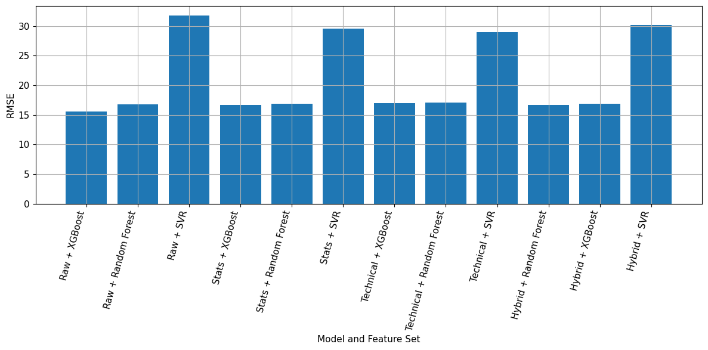

# Short-Term Stock Price Prediction Using Machine Learning

**Moneeb Hsum · BSc Computer Science with Artificial Intelligence · Birmingham City University**

Does adding engineered features improve next-trading-day closing-price forecasts? This final-year project compares three regression models and four feature sets on daily data for Apple (AAPL), JPMorgan Chase (JPM), and ExxonMobil (XOM).

**Raw OHLCV with XGBoost achieved the lowest test RMSE (15.60). Its directional accuracy was 51.34%.** Price-level fit and predicting the direction of the next move tell different stories.



## Experiment

- **Data:** Daily open, high, low, close and volume from 8 February 2013 to 7 February 2018.
- **Target:** Closing price at the next trading session, with features available through the current session.
- **Features:** Raw OHLCV, raw plus rolling statistics and returns, raw plus technical indicators (RSI, MACD, Bollinger Bands and ATR), and a hybrid set combining all groups with lag features.
- **Models:** Support vector regression (SVR), Random Forest and XGBoost. A single model per configuration was trained on pooled ticker data.
- **Evaluation:** An 80/20 chronological split within each ticker. The SVR scaler was fitted on training features. The notebook reports RMSE, MAPE, R² and binary directional accuracy, treating a flat move as non-up.

## Original notebook results

| XGBoost feature set | RMSE | MAPE | R² | Directional accuracy |
| --- | ---: | ---: | ---: | ---: |
| Raw | 15.60 | 5.48% | 0.782 | 51.34% |
| Statistical | 16.72 | 5.98% | 0.750 | 51.08% |
| Technical | 16.94 | 6.08% | 0.743 | 50.27% |
| Hybrid | 16.94 | 6.07% | 0.743 | 50.40% |

See the [full 12-run comparison](results/original_metrics.csv), [actual vs predicted chart](results/actual-vs-predicted.png) and [directional accuracy chart](results/directional-accuracy.png). Engineered features did improve SVR's price errors in some configurations, although none of those configurations beat raw XGBoost.

## Run locally

1. Download `all_stocks_5yr.csv` from the [S&P 500 stock data dataset on Kaggle](https://www.kaggle.com/datasets/camnugent/sandp500) and place it in `data/`. You can also set `STOCK_DATA_PATH` to an existing copy.
2. From the repository root, set up a Python 3.11 or 3.12 environment and launch JupyterLab.

   ```bash
   python -m venv .venv
   source .venv/bin/activate   # Windows PowerShell: .venv\Scripts\Activate.ps1
   python -m pip install -r requirements.txt
   python -m jupyterlab stock_forecasting.ipynb
   ```

3. Run all cells in [the notebook](stock_forecasting.ipynb). The committed tables and charts were extracted from the saved Colab run. Library versions can affect rerun results.

## Limitations

The experiment covers three stocks and one historical test period. The original split is based on feature dates, so the final training row for each ticker uses the first test day's close as its target. A stricter evaluation would purge that boundary row, use walk-forward validation, and compare the models with a persistence forecast that uses today's close as tomorrow's prediction. The saved results do not establish trading profitability.
